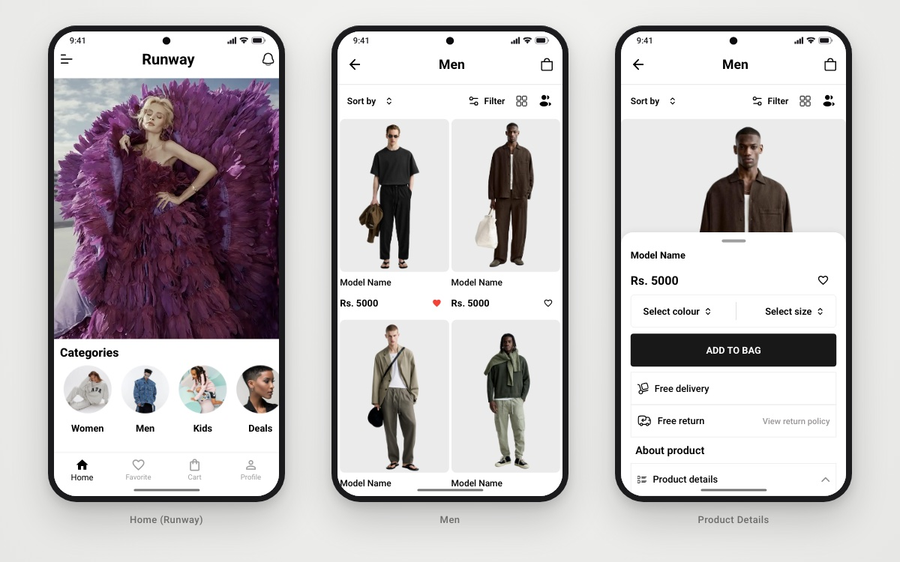

<h1 align="center">StyleSphere</h1>

<p align="center">A fashion-store Flutter app with a video runway home, Rive-animated login and Firebase social sign-in.</p>

<p align="center">
  
  
  
  
  
</p>

<p align="center">
  
  <br/><sub>Home (runway) · Men · Product details</sub>
</p>

## 📖 About

StyleSphere is the front end of a fashion e-commerce app, built while working through a Flutter + Firebase e-commerce course. The home screen plays a looping runway video. Login uses an interactive **Rive** character that follows your typing, covers its eyes while you enter your password, and reacts when sign-in succeeds or fails. Authentication runs on **Firebase Auth** (email/password, Google and Facebook) and follows a clean-architecture layout: repositories return `Either<Failure, T>`, Cubits manage state and `get_it` handles dependency injection.

## ✨ Features

- 🎬 **Animated splash**: an animated logo line that hands off to the login screen.
- 🐻 **Rive login character**: a state machine driven by the form (`isChecking`, `isHandsUp`, `numLook`, `trigSuccess`, `trigFail`).
- 🔐 **Firebase authentication**: email/password sign-up and login, **Google Sign-In** and **Facebook Login**, with friendly error messages.
- 📹 **Runway home**: a looping background video (`video_player`) with a horizontal category strip (Men, Women, Kids, Deals, Health).
- 👕 **Product grid and details**: model cards, a sort/filter bar, and a draggable bottom sheet with *Add to bag*, delivery/return info and product-detail sections.
- ❤️ **Favorites**: a heart toggle on every item, saved locally with `shared_preferences` and listed on a dedicated tab.
- 🧭 **Bottom navigation**: Home, Favorite, Cart and Profile tabs inside a `PageView`.

## 🛠 Tech stack

| Concern | Choice |
|---|---|
| State management | `flutter_bloc` / `bloc` (Cubits) |
| Architecture | Feature-first clean architecture (data / domain / presentation) |
| Functional errors | `dartz` (`Either<Failure, T>`) |
| Dependency injection | `get_it` |
| Backend | `firebase_core`, `firebase_auth`, `firebase_analytics` |
| Social auth | `google_sign_in`, `flutter_facebook_auth` |
| Animation and media | `rive`, `video_player`, `flutter_svg` |
| Local storage | `shared_preferences` |
| UX | `modal_progress_hud_nsn` loading overlay |

## 🏗 Project structure

```
lib/
├── core/
│   ├── errors/             # exceptions and failures
│   ├── helper_functions/   # onGenerateRoute, snack bars
│   ├── services/           # Firebase auth, get_it, shared_preferences
│   ├── utils/              # asset paths
│   └── widgets/            # app bars, buttons, text fields, progress HUD
├── features/
│   ├── splash/             # animated splash and session check
│   ├── auth/               # data/ domain/ presentation/ (login and sign-up Cubits)
│   └── home/               # runway home, categories, item details, favorites
├── firebase_options.dart
└── main.dart
assets/
├── images/  logo/  svgs/
└── video/                  # runway video and Rive files
```

## 🚀 Getting started

**Prerequisites:** Flutter SDK (Dart `^3.8.1`) and an Android or iOS device/emulator.

```bash
git clone https://github.com/youssef336/StyleSphere.git
cd StyleSphere
flutter pub get
flutter run
```

**Firebase:** the app initializes Firebase from `lib/firebase_options.dart`. To use your own project, run `flutterfire configure` and enable the Email/Password, Google and Facebook providers in the Firebase console. Facebook Login also needs your own Facebook App ID and client token in the Android/iOS native config.

## 👤 Author

**Youssef Belal Zakaria** · [GitHub @youssef336](https://github.com/youssef336)

⭐ If you like this project, give it a star!
